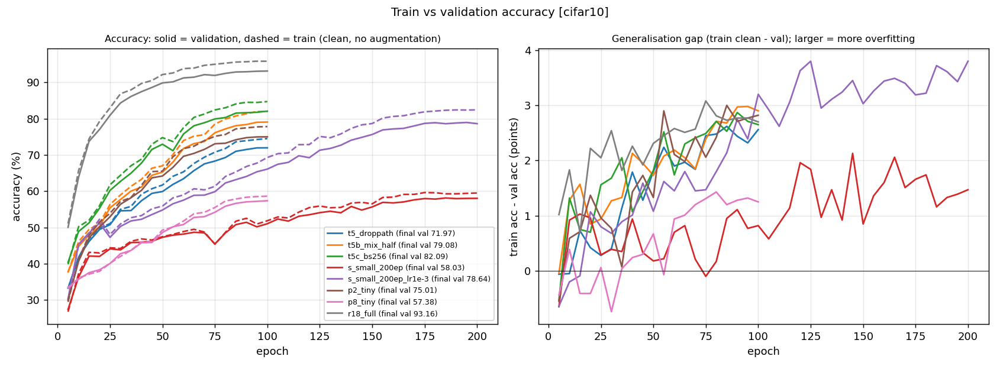
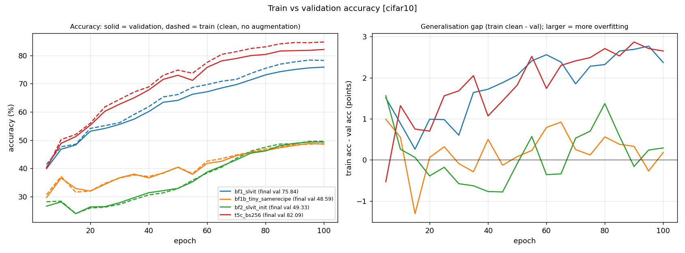
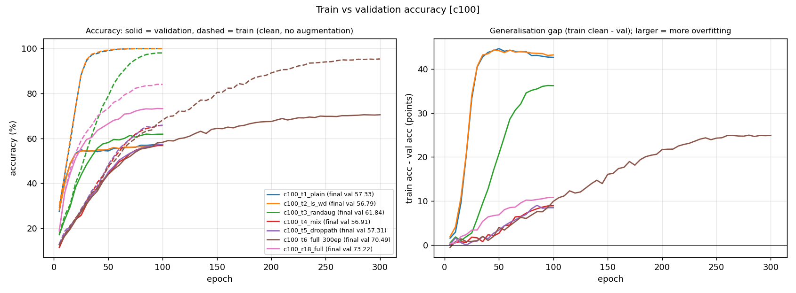
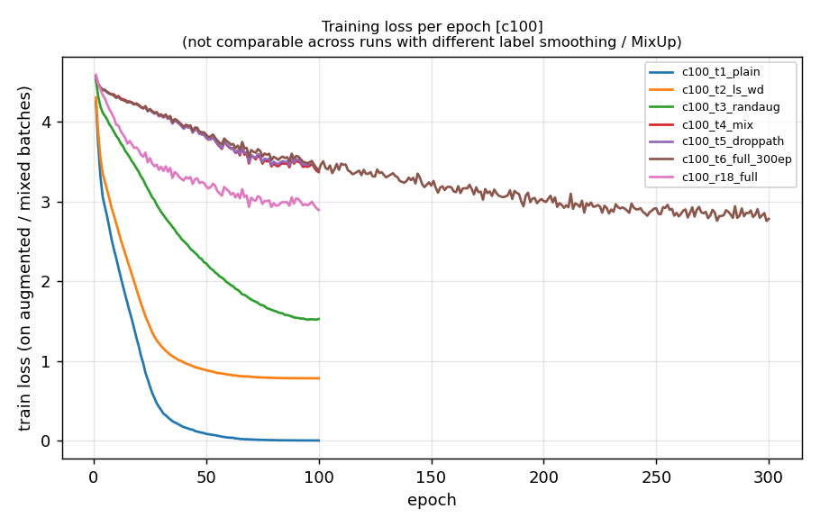
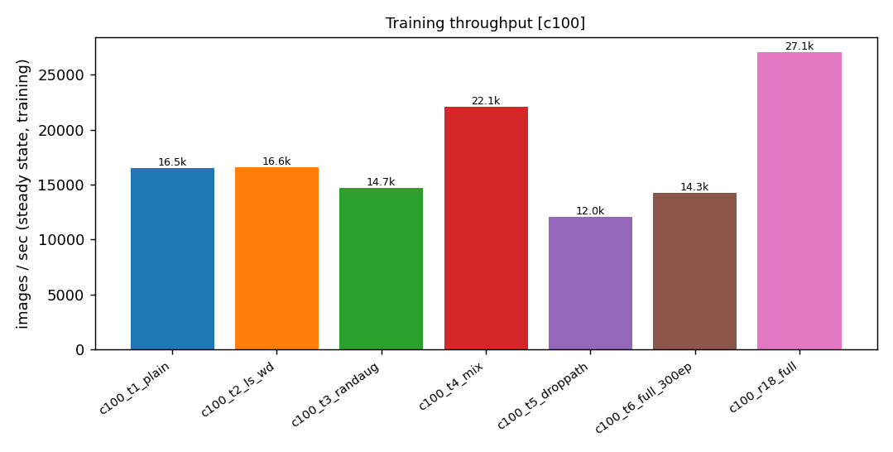
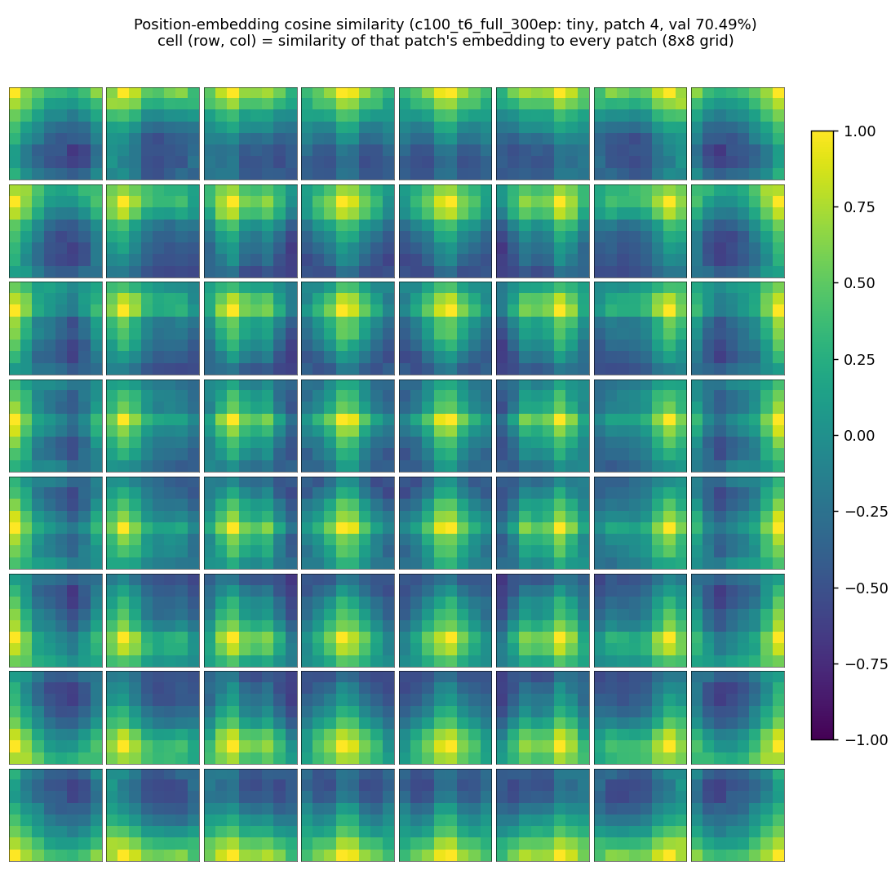
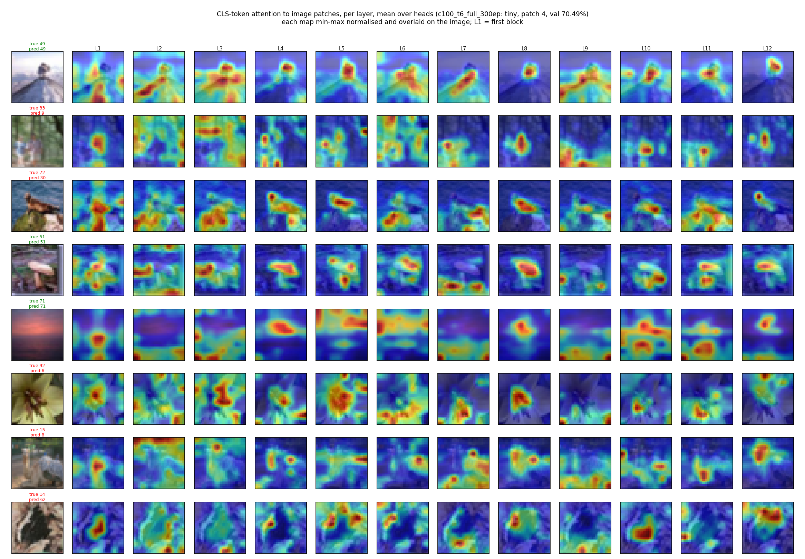

# ViT training report

_Raw per-run tables. The step-by-step educational report with the edge track, SOTA comparisons and sources is `DASHBOARD.html` (generated by `make_dashboard.py`)._

_Generated 2026-10-13 16:34 from `/home/ubuntu/workspace/vision_models/ViT/runs`; 201 runs included._

Gap = clean train acc minus val acc (points). Val acc shows final epoch, best in parentheses when different.

## Compute summary

| section | runs done | pending | GPU minutes | cost |
|---|---|---|---|---|
| CIFAR-10 | 59 | 0 | 2931.6 | $160.75 |
| CIFAR-100 | 124 | 0 | 8089.5 | $443.57 |
| Tiny-ImageNet | 8 | 0 | 256.9 | $14.09 |
| ImageNet-64 | 7 | 0 | 1216.1 | $66.68 |
| **Total (sum of run-minutes)** | 201 | 0 | **12494.1** (208.23 h) | $685.09 at $3.29/h (upper bound) |

**Wall-clock (estimated, counting in-progress runs up to now):** 4415 min (73.58 h) from the earliest run start (2026-10-10 15:00) to the latest run end (2026-10-13 16:34); **GPU cost on wall-clock: $242.07** at $3.29/h.
Sum of completed run-minutes is 12494 min. Completed runs rarely overlapped (peak 8), so the span exceeds the sum of run-minutes by idle gaps and startup/eval time (the sum will overstate wall-clock once the concurrent queues complete); 2 runs currently in progress (86 min elapsed so far; peak concurrency now 8) are counted in the span but not in the sum; time with at least one run active is 4212 min ($230.94). Start = run-directory creation time (falls back to results.json mtime minus total_minutes), end = results.json mtime (in-progress runs end at report time). Per-run minutes and img/s of overlapping runs are inflated by GPU sharing.

## CIFAR-10

| run | epochs | params (M) | clean train acc | val acc | train-val gap | minutes | img/s | what this step taught |
|---|---|---|---|---|---|---|---|---|
| t1_plain | 100 | 5.36 | 100.00 | 82.90 | 17.1 | 4.3 | 21,861 | baseline (crop+flip only) |
| t2_ls_wd | 100 | 5.36 | 99.95 | 83.07 (83.11) | 16.9 | 2.6 | 35,280 | +label smoothing+weight decay: val +0.2 pts, gap shrinks 17→17 |
| t3_randaug | 100 | 5.36 | 93.21 | 85.96 | 7.2 | 3.0 | 29,440 | +RandAugment: val +2.9 pts, gap shrinks 17→7 |
| t4_mix | 100 | 5.36 | 72.89 | 70.92 | 2.0 | 3.0 | 29,650 | +MixUp/CutMix: val -15.0 pts, gap shrinks 7→2 |
| t5_droppath | 100 | 5.36 | 74.53 | 71.97 | 2.6 | 3.6 | 29,233 | +drop-path: val +1.0 pts, gap grows 2→3 |
| t6_full_300ep | 300 | 5.36 | 92.80 | 87.96 | 4.8 | 12.9 | 19,535 | epochs 100->300: val +16.0 pts, gap grows 3→5 |
| r18_full | 100 | 11.17 | 95.86 | 93.16 | 2.7 | 3.0 | 31,982 | vs matching ViT (t5_droppath): val +21.2 pts (better), gap 3 vs 3, 0.8x the time; conv inductive bias helps at this budget |
| t5b_mix_half | 100 | 5.36 | 81.98 | 79.08 | 2.9 | 4.4 | 19,504 | vs t5_droppath: mix-prob 1.0->0.5: val +7.1 pts, gap 3->3, img/s x0.67. t5 underfit (train acc ~ val acc, both low) so MixUp/CutMix was too strong for a 100-epoch budget; applying it to only half the batches makes the task easier |
| t5c_bs256 | 100 | 5.36 | 84.74 | 82.09 | 2.6 | 16.5 | 5,198 | vs t5_droppath: batch 1024->256, lr 0.002->0.001: val +10.1 pts, gap 3->3, img/s x0.18. 4x more optimizer steps for the same 100 epochs (lr scaled 2e-3->1e-3); steps, not regularization, were the limit. img/s is lower because this run was not CUDA-graphed |
| s_small_200ep | 200 | 21.34 | 59.50 | 58.03 (58.13) | 1.5 | 11.0 | 16,073 | ViT-Small vs Tiny (t5_droppath): val -13.9 pts, 21.3M vs 5.4M params, 200 vs 100 epochs |
| s_small_200ep_lr1e-3 | 200 | 21.34 | 82.44 | 78.64 (78.97) | 3.8 | 10.6 | 16,117 | vs s_small_200ep: lr 0.002->0.001: val +20.6 pts, gap 1->4, img/s x1.00. the lr 2e-3 Small run stalled (loss plateau ~2.1); halving the LR trains it, so that failure was optimization, not capacity |
| p2_tiny | 100 | 5.39 | 77.83 | 75.01 | 2.8 | 9.8 | 9,143 | vs t5_droppath: patch 4->2: val +3.0 pts, gap 3->3, img/s x0.31. patch 2 = (32/2)^2 = 256 tokens vs 64; same heavy (underfitting) recipe, so this shows what the extra tokens buy when steps are fixed; img/s was measured with other queues on the GPU, so treat it as indicative |
| p8_tiny | 100 | 5.38 | 58.63 | 57.38 | 1.2 | 4.5 | 20,565 | vs t5_droppath: patch 4->8: val -14.6 pts, gap 3->1, img/s x0.70. patch 8 = (32/8)^2 = 16 tokens vs 64; same heavy (underfitting) recipe; cheaper but loses spatial detail; img/s was measured with other queues on the GPU, so treat it as indicative |
| bf1_slvit | 100 | 2.70 | 78.21 | 75.84 | 2.4 | 10.7 | 8,163 | vs t5c_bs256: model tiny->slvit, batch 256->128, lr 0.001->0.003, warmup 5->10: val -6.2 pts, gap 3->2, img/s x1.57. SL-ViT shape (9 layers, 12 heads, MLP 2, 2.7M params) with the SL-ViT recipe (batch 128, lr 3e-3, warmup 10, reprob 0.25), compared with the best same-budget Tiny run |
| bf1b_tiny_samerecipe | 100 | 5.36 | 48.77 | 48.59 (48.87) | 0.2 | 11.8 | 7,092 | vs bf1_slvit: model slvit->tiny: val -27.2 pts, gap 2->0, img/s x0.87. shape effect: identical SL-ViT recipe, but our 12-layer / 3-head / MLP-4 Tiny; train acc is also low, so it is an optimization stall, not overfitting |
| bf2_slvit_init | 100 | 2.70 | 49.62 | 49.33 (49.36) | 0.3 | 10.3 | 8,299 | vs bf1_slvit: init default->impulse: val -26.5 pts, gap 2->0, img/s x1.02. init effect: identical to bf1 but impulse init; train acc is also low, so training stalled (suspect lr 3e-3 with this init; bf1_slvit_lr* will tell) |
| bf3_slvit_300ep | 300 | 2.70 | 97.94 | 90.40 (90.53) | 7.5 | 37.8 | 6,674 | no comparison available |
| bf4_slvit_300ep_mixhalf | 300 | 2.70 | 99.39 | 93.44 (93.50) | 6.0 | 53.4 | 4,762 | no comparison available |
| bf1_slvit_lr1e-3 | 100 | 2.70 | 85.50 | 82.40 | 3.1 | 11.7 | 7,416 | no comparison available |
| bf1_slvit_lr5e-4 | 100 | 2.70 | 86.70 | 83.67 | 3.0 | 11.7 | 7,323 | no comparison available |
| rd_pilot_a | 100 | 2.77 | 82.29 | 80.19 | 2.1 | 15.7 | 5,602 | no comparison available |
| rd_pilot_b | 100 | 2.69 | 87.41 | 84.66 | 2.8 | 15.5 | 5,651 | no comparison available |
| rd_pilot_noinject | 100 | 2.69 | 82.98 | 80.82 | 2.2 | 14.5 | 6,029 | no comparison available |
| rd_flat6 | 100 | 2.69 | 86.33 | 83.48 | 2.8 | 13.0 | 6,896 | no comparison available |
| abl_cls | 300 | 2.70 | 99.22 | 92.97 | 6.2 | 78.9 | 3,227 | no comparison available |
| abl_default_init | 300 | 2.70 | 99.17 | 92.57 (92.67) | 6.6 | 75.2 | 3,281 | no comparison available |
| abl_no_lsa | 300 | 2.70 | 97.89 | 90.66 | 7.2 | 68.0 | 4,030 | no comparison available |
| abl_tiny_shape | 300 | 5.36 | 99.70 | 94.54 | 5.2 | 78.7 | 3,236 | no comparison available |
| abl_tiny_shape_seed1 | 300 | 5.36 | 99.68 | 94.61 | 5.1 | 46.2 | 5,743 | no comparison available |
| abl_tiny_shape_seed2 | 300 | 5.36 | 99.68 | 94.63 (94.64) | 5.1 | 38.5 | 6,612 | no comparison available |
| bf3b_seed1 | 300 | 2.70 | 99.00 | 93.16 (93.25) | 5.8 | 70.0 | 3,873 | no comparison available |
| bf3b_seed2 | 300 | 2.70 | 98.94 | 93.26 | 5.7 | 74.2 | 3,248 | no comparison available |
| bf3b_slvit_300ep_lr5e-4 | 300 | 2.70 | 99.04 | 93.37 | 5.7 | 43.8 | 6,392 | no comparison available |
| bf4_seed1 | 300 | 2.70 | 99.44 | 93.55 | 5.9 | 79.4 | 3,191 | no comparison available |
| bf4_seed2 | 300 | 2.70 | 99.38 | 93.24 | 6.1 | 80.0 | 3,145 | no comparison available |
| c10_spt_slvit_1000ep | 1000 | 2.74 | 100.00 | 97.03 (97.07) | 3.0 | 178.1 | 4,775 | no comparison available |
| c10_spt_slvit_1000ep_s1 | 1000 | 2.74 | 100.00 | 96.51 (96.65) | 3.5 | 175.1 | 4,886 | no comparison available |
| c10_spt_slvit_1000ep_s2 | 1000 | 2.74 | 100.00 | 96.71 (96.87) | 3.3 | 171.4 | 4,881 | no comparison available |
| c10_spt_tinyshape_1000ep | 1000 | 5.40 | 100.00 | 96.86 | 3.1 | 176.1 | 4,800 | no comparison available |
| c10_spt_tinyshape_1000ep_holdout | 1000 | 5.40 | 100.00 | 96.80 (96.98) | 3.2 | 159.2 | 4,793 | no comparison available |
| c10_spt_tinyshape_1000ep_s1 | 1000 | 5.40 | 100.00 | 96.92 (96.97) | 3.1 | 176.7 | 4,808 | no comparison available |
| c10_spt_tinyshape_1000ep_s2 | 1000 | 5.40 | 100.00 | 96.84 | 3.2 | 175.7 | 4,812 | no comparison available |
| c10_tinyshape_bf3b_1000ep | 1000 | 5.36 | 100.00 | 96.39 (96.62) | 3.6 | 151.9 | 4,873 | no comparison available |
| c10_tinyshape_bf3b_1000ep_s1 | 1000 | 5.36 | 100.00 | 96.61 (96.73) | 3.4 | 173.2 | 4,822 | no comparison available |
| c10_tinyshape_bf3b_1000ep_s2 | 1000 | 5.36 | 100.00 | 96.61 (96.78) | 3.4 | 125.9 | 6,701 | no comparison available |
| ptq_full_minmax | 0 | nan | n/a | n/a | n/a | 0.0 | 0 | incomplete results |
| ptq_full_mse | 0 | nan | n/a | n/a | n/a | 0.0 | 0 | incomplete results |
| ptq_full_pct | 0 | nan | n/a | n/a | n/a | 0.0 | 0 | incomplete results |
| ptq_mm_w | 0 | nan | n/a | n/a | n/a | 0.0 | 0 | incomplete results |
| ptq_mm_w_input | 0 | nan | n/a | n/a | n/a | 0.0 | 0 | incomplete results |
| ptq_no_residual | 0 | nan | n/a | n/a | n/a | 0.0 | 0 | incomplete results |
| rd_deep_r8 | 100 | 2.77 | 83.89 | 81.99 | 1.9 | 22.0 | 3,678 | no comparison available |
| rd_deep_r8_add | 100 | 2.69 | 87.33 | 84.42 | 2.9 | 22.3 | 3,795 | no comparison available |
| rd_deep_r8_add_ds | 100 | 2.69 | 88.14 | 85.23 | 2.9 | 31.9 | 2,473 | no comparison available |
| rd_deep_r8_add_ds_seed1 | 100 | 2.69 | 87.66 | 85.02 | 2.6 | 48.3 | 1,782 | no comparison available |
| rd_deep_r8_add_ds_seed2 | 100 | 2.69 | 87.52 | 84.95 | 2.6 | 43.3 | 1,930 | no comparison available |
| rd_deep_r8_ds | 100 | 2.77 | 83.78 | 81.76 | 2.0 | 35.6 | 2,374 | no comparison available |
| rd_deep_single | 100 | 2.32 | 82.95 | 80.51 | 2.4 | 20.8 | 4,092 | no comparison available |
| rd_deep_single_add | 100 | 2.25 | 85.80 | 83.57 (83.59) | 2.2 | 16.1 | 5,387 | no comparison available |

Subtotal: **2931.6 GPU min** (48.86 h), **$160.75**

### Comparison with published results

Reference rows are from `REFERENCES.md` (verified 2026-10-10; epochs/batch differ from ours, so this is a rough yardstick, not a controlled comparison).

| model | params | setting | acc (%) | our best ViT minus ref | our best CNN minus ref | type | source |
|---|---|---|---|---|---|---|---|
| **ours: c10_spt_slvit_1000ep** (slvit, 1000 ep, batch 128) | 2.7M | this repo | 97.03 |  |  | ViT | this repo |
| **ours: r18_full** (resnet18, 100 ep, batch 1024) | 11.2M | this repo | 93.16 |  |  | CNN | this repo |
| ViT-Tiny 192/12/3 p4, plain init (mimetic-init paper baseline) | ~5.4M | 100 ep, batch 512, RandAug+Cutout | 88.43 | +8.6 | +4.7 | ViT | [arXiv 2305.09828 Tab. 7](https://arxiv.org/html/2305.09828) |
| DeiT-T patch 2 (NesT authors) | 5.3M | n/s | 88.39 | +8.6 | +4.8 | ViT | [arXiv 2105.12723 Tab. A3](https://arxiv.org/html/2105.12723) |
| ViT-Lite-7/4, no aug / no tuning | 3.72M | 300 ep | 83.59 | +13.4 | +9.6 | ViT | [arXiv 2104.05704 Tab. 8](https://arxiv.org/html/2104.05704v4) |
| ViT-12/16 | 85.6M | 300 ep, batch 128 | 83.04 | +14.0 | +10.1 | ViT | [arXiv 2104.05704 Tab. 1](https://arxiv.org/html/2104.05704v4) |
| omihub777/ViT-CIFAR (7L, dim 384) | 6.3M | 200 ep, batch 128 | 90.92 | +6.1 | +2.2 | ViT | [GitHub](https://github.com/omihub777/ViT-CIFAR) |
| ViT-Lite-7/4, full DeiT-style recipe | 3.72M | 300 ep, batch 128 | 93.57 | +3.5 | -0.4 | ViT | [arXiv 2104.05704 Tab. 1](https://arxiv.org/html/2104.05704v4) |
| ViT baseline (depth 9, dim 192), SPT/LSA paper | 2.8M | 100 ep, batch 128 | 93.58 | +3.5 | -0.4 | ViT | [arXiv 2112.13492 Tab. 2](https://arxiv.org/html/2112.13492v1) |
| SL-ViT (ViT + SPT + LSA) | 2.9M | 100 ep, batch 128 | 94.53 | +2.5 | -1.4 | ViT (locality) | [arXiv 2112.13492 Tab. 2](https://arxiv.org/html/2112.13492v1) |
| CCT-7/3x1 (conv tokenizer, hybrid) | 3.76M | 300 ep, batch 128 | 96.53 | +0.5 | -3.4 | hybrid | [arXiv 2104.05704 Tab. 1](https://arxiv.org/html/2104.05704v4) |
| ResNet-110 (He et al.) | 1.7M | ~164 ep, batch 128 | 93.57 | +3.5 | -0.4 | CNN | [arXiv 1512.03385 Tab. 6](https://ar5iv.labs.arxiv.org/html/1512.03385) |
| ResNet18 (kuangliu/pytorch-cifar) | 11M | n/s | 93.02 | +4.0 | +0.1 | CNN | [GitHub](https://github.com/kuangliu/pytorch-cifar) |
| ResNet18 (Cutout paper), crop+flip | 11M | 200 ep, batch 128 | 95.28 | +1.8 | -2.1 | CNN | [arXiv 1708.04552](https://ar5iv.labs.arxiv.org/html/1708.04552) |
| WRN-28-10 | 36.5M | 200 ep | 96.00 | +1.0 | -2.8 | CNN | [arXiv 1605.07146](https://ar5iv.labs.arxiv.org/html/1605.07146) |
| airbench94 (Keller Jordan) | small CNN | 3.29 s on 1x A100 | 94.00 | +3.0 | -0.8 | CNN | [arXiv 2404.00498](https://arxiv.org/abs/2404.00498) |

## CIFAR-100

| run | epochs | params (M) | clean train acc | val acc | train-val gap | minutes | img/s | what this step taught |
|---|---|---|---|---|---|---|---|---|
| c100_t1_plain | 100 | 5.38 | 99.97 | 57.33 | 42.6 | 5.5 | 16,505 | baseline (crop+flip only) |
| c100_t2_ls_wd | 100 | 5.38 | 99.98 | 56.79 (56.89) | 43.2 | 5.2 | 16,557 | +label smoothing+weight decay: val -0.5 pts, gap grows 43→43 |
| c100_t3_randaug | 100 | 5.38 | 98.04 | 61.84 (61.88) | 36.2 | 5.8 | 14,714 | +RandAugment: val +5.1 pts, gap shrinks 43→36 |
| c100_t4_mix | 100 | 5.38 | 65.81 | 56.91 | 8.9 | 4.7 | 22,091 | +MixUp/CutMix: val -4.9 pts, gap shrinks 36→9 |
| c100_t5_droppath | 100 | 5.38 | 65.76 | 57.31 | 8.5 | 8.2 | 12,038 | +drop-path: val +0.4 pts, gap shrinks 9→8 |
| c100_t6_full_300ep | 300 | 5.38 | 95.38 | 70.49 | 24.9 | 16.7 | 14,250 | epochs 100->300: val +13.2 pts, gap grows 8→25 |
| c100_r18_full | 100 | 11.22 | 84.00 | 73.22 (73.30) | 10.8 | 3.6 | 27,102 | vs matching ViT (c100_t5_droppath): val +15.9 pts (better), gap 11 vs 8, 0.4x the time; conv inductive bias helps at this budget |
| c100_s_small_200ep | 200 | 21.38 | 95.25 | 68.01 (68.32) | 27.2 | 13.9 | 12,947 | ViT-Small vs Tiny (c100_t5_droppath): val +10.7 pts, 21.4M vs 5.4M params, 200 vs 100 epochs |
| c100_bf3b_slvit_1000ep | 1000 | 2.72 | 99.94 | 79.78 (79.84) | 20.2 | 170.7 | 4,834 | no comparison available |
| c100_bf3b_slvit_1000ep_s1 | 1000 | 2.72 | 99.95 | 78.62 (78.63) | 21.3 | 173.1 | 4,815 | no comparison available |
| c100_bf3b_slvit_1000ep_s2 | 1000 | 2.72 | 99.95 | 78.69 (78.98) | 21.3 | 152.1 | 4,804 | no comparison available |
| c100_bf3b_slvit_300ep_lr5e-4 | 300 | 2.72 | 97.81 | 75.69 | 22.1 | 52.1 | 4,897 | no comparison available |
| c100_dense_vit_150ep | 150 | 5.38 | 93.37 | 71.43 | 21.9 | 27.3 | 4,624 | no comparison available |
| ec100_T_eva02s_224 | 30 | 21.66 | 96.57 | 92.26 | 4.3 | 49.4 | 555 | no comparison available |
| ec100_T_vitb_ar2_224 | 20 | 85.88 | 98.59 | 93.43 | 5.2 | 49.8 | 355 | no comparison available |
| ec100_convnext_at_128 | 30 | 3.41 | 91.83 | 82.95 | 8.9 | 9.8 | 3,254 | no comparison available |
| ec100_convnext_at_224 | 30 | 3.41 | 93.12 | 84.87 | 8.2 | 15.6 | 1,846 | no comparison available |
| ec100_deit_t_128 | 30 | 5.52 | 89.16 | 82.69 | 6.5 | 8.3 | 3,254 | no comparison available |
| ec100_deit_t_224 | 30 | 5.54 | 90.89 | 84.46 | 6.4 | 15.2 | 1,734 | no comparison available |
| ec100_dense_in64pre_tiny_64_60ep | 60 | 5.41 | 93.67 | 83.06 (83.07) | 10.6 | 11.4 | 4,580 | no comparison available |
| ec100_dense_in64pre_tiny_64_s1 | 30 | 5.41 | 89.24 | 81.81 | 7.4 | 7.5 | 3,542 | no comparison available |
| ec100_edgenext_xs_128 | 30 | 2.16 | 85.32 | 79.97 | 5.3 | 12.5 | 2,403 | no comparison available |
| ec100_edgenext_xs_224 | 30 | 2.16 | 87.09 | 81.52 | 5.6 | 28.2 | 1,131 | no comparison available |
| ec100_effformv2_s0_128 | 30 | 3.28 | 90.43 | 83.39 | 7.0 | 24.4 | 2,022 | no comparison available |
| ec100_effformv2_s0_224 | 30 | 3.28 | 91.83 | 85.45 | 6.4 | 36.7 | 939 | no comparison available |
| ec100_effvit_m0_128 | 30 | 2.18 | 80.08 | 73.61 | 6.5 | 12.0 | 2,556 | no comparison available |
| ec100_effvit_m0_224 | 30 | 2.18 | 86.88 | 80.00 | 6.9 | 13.3 | 2,259 | no comparison available |
| ec100_effvit_m1_128 | 30 | 2.81 | 83.70 | 77.25 | 6.5 | 11.6 | 2,639 | no comparison available |
| ec100_effvit_m1_224 | 30 | 2.81 | 88.67 | 82.18 | 6.5 | 11.8 | 2,776 | no comparison available |
| ec100_fastvit_t8_128 | 30 | 3.33 | 92.81 | 83.33 | 9.5 | 18.9 | 1,449 | no comparison available |
| ec100_fastvit_t8_224 | 30 | 3.33 | 94.27 | 85.68 | 8.6 | 95.6 | 291 | no comparison available |
| ec100_fm_repvit_128_e1000 | 1000 | 4.80 | 97.84 | 88.63 (88.64) | 9.2 | 460.8 | 1,908 | no comparison available |
| ec100_fm_repvit_224_e200 | 200 | 4.80 | 97.39 | 89.93 | 7.5 | 263.4 | 635 | no comparison available |
| ec100_fm_repvit_224_e200_s1 | 200 | 4.80 | 97.45 | 89.76 (89.87) | 7.7 | 273.6 | 628 | no comparison available |
| ec100_fm_repvit_224_e30 | 30 | 4.80 | 94.90 | 88.48 | 6.4 | 24.3 | 1,195 | no comparison available |
| ec100_fm_repvit_224_e400 | 400 | 4.80 | 97.62 | 89.70 (89.86) | 7.9 | 553.5 | 619 | no comparison available |
| ec100_fm_tinyvit5m_224_e200 | 200 | 5.10 | 96.70 | 90.32 (90.38) | 6.4 | 292.7 | 569 | no comparison available |
| ec100_fm_tinyvit5m_224_e200_s1 | 200 | 5.10 | 96.73 | 90.47 (90.56) | 6.3 | 308.0 | 560 | no comparison available |
| ec100_fm_tinyvit5m_224_e400 | 400 | 5.10 | 97.44 | 90.47 (90.60) | 7.0 | 624.7 | 548 | no comparison available |
| ec100_iformer_t_128 | 30 | 2.66 | 89.68 | 83.26 | 6.4 | 10.5 | 2,907 | no comparison available |
| ec100_iformer_t_224 | 30 | 2.66 | 91.25 | 85.20 | 6.0 | 18.4 | 1,480 | no comparison available |
| ec100_in21kpre_tiny_64 | 30 | 5.41 | 90.26 | 82.47 | 7.8 | 5.4 | 4,852 | no comparison available |
| ec100_in21kpre_tiny_64_kd | 30 | 5.41 | 90.07 | 82.81 | 7.3 | 20.2 | 1,258 | no comparison available |
| ec100_in21kpre_tiny_p4_64 | 30 | 5.42 | 92.19 | 84.27 | 7.9 | 16.3 | 1,624 | no comparison available |
| ec100_in21kpre_tiny_p4_64_kd | 30 | 5.42 | 91.72 | 84.75 | 7.0 | 31.9 | 807 | no comparison available |
| ec100_in21kpre_tiny_p4_64_kd_120ep | 120 | 5.42 | 98.06 | 87.82 (87.84) | 10.2 | 127.6 | 813 | no comparison available |
| ec100_in21kpre_tiny_p4_64_kd_120ep_s1 | 120 | 5.42 | 98.07 | 87.60 (87.61) | 10.5 | 126.1 | 826 | no comparison available |
| ec100_in21kpre_tiny_p4_64_kd_200ep | 200 | 5.42 | 99.04 | 88.14 | 10.9 | 215.9 | 792 | no comparison available |
| ec100_in21kpre_tiny_p4_64_kd_60ep | 60 | 5.42 | 95.24 | 86.87 | 8.4 | 64.1 | 802 | no comparison available |
| ec100_in21kpre_tiny_p4_64_kd_60ep_s1 | 60 | 5.42 | 95.52 | 86.90 | 8.6 | 63.0 | 815 | no comparison available |
| ec100_in21kpre_tiny_p8_128_kd_60ep | 60 | 5.44 | 95.33 | 86.28 | 9.0 | 66.6 | 789 | patch 8: tokens = (32/8)^2 = 16 vs 64 for patch 4; val +29.0 pts, 0.07x img/s (slower); token count change did not pay off in accuracy |
| ec100_in64pre_slvit_64 | 30 | 2.74 | 85.58 | 78.84 | 6.7 | 4.8 | 5,757 | no comparison available |
| ec100_in64pre_slvit_64_kd | 30 | 2.74 | 84.70 | 78.95 | 5.8 | 8.2 | 2,996 | no comparison available |
| ec100_in64pre_tiny_64 | 30 | 5.41 | 89.51 | 81.17 | 8.3 | 5.8 | 4,727 | no comparison available |
| ec100_in64pre_tiny_64_kd | 30 | 5.41 | 88.49 | 81.47 | 7.0 | 5.9 | 4,401 | no comparison available |
| ec100_in64pre_tiny_p4_32 | 30 | 5.38 | 88.61 | 80.60 | 8.0 | 7.2 | 3,970 | no comparison available |
| ec100_in64pre_tiny_p4_64 | 30 | 5.42 | 91.41 | 83.78 | 7.6 | 18.1 | 1,641 | no comparison available |
| ec100_in64pre_tiny_p4_64_kd | 30 | 5.42 | 90.67 | 84.08 | 6.6 | 29.1 | 868 | no comparison available |
| ec100_kd60_dist_repvit_224 | 60 | 4.80 | 97.98 | 89.34 (89.41) | 8.6 | 67.0 | 792 | no comparison available |
| ec100_kd60_lsd_repvit_224 | 60 | 4.80 | 98.53 | 89.38 (89.41) | 9.2 | 26.5 | 2,534 | no comparison available |
| ec100_kd60_soft_repvit_224 | 60 | 4.80 | 98.63 | 89.03 (89.06) | 9.6 | 85.3 | 605 | no comparison available |
| ec100_kd_deit_t_224 | 30 | 5.54 | 90.29 | 84.71 | 5.6 | 26.8 | 933 | no comparison available |
| ec100_kd_effformv2_s0_128 | 30 | 3.28 | 89.91 | 83.53 | 6.4 | 41.3 | 983 | no comparison available |
| ec100_kd_fastvit_t8_128 | 30 | 3.33 | 92.45 | 84.03 | 8.4 | 36.2 | 783 | no comparison available |
| ec100_kd_iformer_t_128 | 30 | 2.66 | 89.46 | 83.58 | 5.9 | 35.0 | 738 | no comparison available |
| ec100_kd_repvit_m0_9_128 | 30 | 4.80 | 95.83 | 87.81 | 8.0 | 34.5 | 686 | no comparison available |
| ec100_kd_tinyvit_5m_128 | 30 | 5.10 | 90.91 | 86.78 | 4.1 | 32.5 | 830 | no comparison available |
| ec100_kd_tinyvit_5m_224 | 30 | 5.10 | 92.53 | 88.31 | 4.2 | 63.1 | 409 | no comparison available |
| ec100_kdhard_deit_t_224 | 30 | 5.54 | 91.32 | 84.87 | 6.4 | 30.2 | 793 | no comparison available |
| ec100_mnv4_cs_128 | 30 | 2.62 | 84.35 | 76.22 | 8.1 | 6.6 | 4,583 | no comparison available |
| ec100_mnv4_cs_224 | 30 | 2.62 | 88.26 | 80.08 | 8.2 | 9.6 | 3,291 | no comparison available |
| ec100_mnv4_hm_128 | 30 | 9.92 | 81.14 | 74.27 | 6.9 | 12.1 | 2,473 | no comparison available |
| ec100_mnv4_hm_128_lr1e-4 | 30 | 9.92 | 94.54 | 85.67 | 8.9 | 9.6 | 2,871 | no comparison available |
| ec100_mnv4_hm_224 | 30 | 9.92 | 5.97 | 6.15 | -0.2 | 24.4 | 1,120 | no comparison available |
| ec100_mnv4_hm_224_lr1e-4 | 30 | 9.92 | 96.77 | 88.18 | 8.6 | 9.1 | 3,069 | no comparison available |
| ec100_moe_repvit_k4_128 | 30 | 10.82 | 96.56 | 87.18 | 9.4 | 13.6 | 1,933 | no comparison available |
| ec100_moe_repvit_k4_224 | 30 | 10.82 | 97.33 | 88.77 | 8.6 | 32.0 | 875 | no comparison available |
| ec100_moe_repvit_k4_224_s1 | 30 | 10.82 | 97.30 | 88.12 (88.32) | 9.2 | 31.7 | 831 | no comparison available |
| ec100_moe_repvit_k8_128 | 30 | 18.85 | 96.79 | 87.31 | 9.5 | 15.9 | 1,922 | no comparison available |
| ec100_mvit_xs_128 | 30 | 1.97 | 80.69 | 76.84 | 3.8 | 26.2 | 1,062 | no comparison available |
| ec100_mvit_xs_224 | 30 | 1.97 | 80.89 | 76.72 | 4.2 | 62.1 | 489 | no comparison available |
| ec100_mvitv2_075_128 | 30 | 2.52 | 82.94 | 78.35 | 4.6 | 14.4 | 1,887 | no comparison available |
| ec100_mvitv2_075_224 | 30 | 2.52 | 82.60 | 78.09 | 4.5 | 43.8 | 671 | no comparison available |
| ec100_nokd_repvit_224_e200 | 200 | 4.80 | 99.94 | 87.70 (87.90) | 12.2 | 171.9 | 1,018 | no comparison available |
| ec100_repvit_m0_9_128 | 30 | 4.80 | 96.39 | 87.42 | 9.0 | 12.5 | 2,481 | no comparison available |
| ec100_repvit_m0_9_224 | 30 | 4.80 | 97.02 | 88.33 | 8.7 | 29.6 | 1,034 | no comparison available |
| ec100_repvit_m0_9_224_s1 | 30 | 4.80 | 96.93 | 88.29 (88.41) | 8.6 | 27.4 | 983 | no comparison available |
| ec100_repvit_m0_9_256 | 30 | 4.80 | 97.15 | 88.63 | 8.5 | 36.9 | 790 | no comparison available |
| ec100_repvit_m0_9_288 | 30 | 4.80 | 97.00 | 88.37 | 8.6 | 43.5 | 628 | no comparison available |
| ec100_starnet_s1_128 | 30 | 2.70 | 89.73 | 81.89 | 7.8 | 8.4 | 3,535 | no comparison available |
| ec100_starnet_s1_224 | 30 | 2.70 | 90.53 | 83.90 | 6.6 | 17.0 | 1,703 | no comparison available |
| ec100_tinyvit_5m_128 | 30 | 5.10 | 91.16 | 86.25 | 4.9 | 22.7 | 1,222 | no comparison available |
| ec100_tinyvit_5m_128_lr1e-3 | 30 | 5.10 | 92.75 | 86.51 | 6.2 | 19.0 | 1,701 | no comparison available |
| ec100_tinyvit_5m_128_lr2.5e-4 | 30 | 5.10 | 88.01 | 84.73 | 3.3 | 24.2 | 1,082 | no comparison available |
| ec100_tinyvit_5m_224 | 30 | 5.10 | 92.43 | 88.24 | 4.2 | 30.4 | 853 | no comparison available |
| ec100_upcyc_in64pre_tiny_e4_64 | 30 | 8.96 | 90.13 | 81.56 | 8.6 | 8.1 | 3,642 | no comparison available |
| ec100_upcyc_in64pre_tiny_e4_64_60ep | 60 | 8.96 | 94.85 | 83.12 | 11.7 | 16.2 | 3,591 | no comparison available |
| ec100_upcyc_in64pre_tiny_e4_64_s1 | 30 | 8.96 | 89.98 | 80.62 (80.63) | 9.4 | 7.9 | 3,692 | no comparison available |
| ec100_vit_t_ar_128 | 30 | 5.52 | 88.03 | 83.12 | 4.9 | 8.1 | 3,250 | no comparison available |
| ec100_vit_t_ar_224 | 30 | 5.54 | 90.14 | 85.62 | 4.5 | 12.2 | 2,128 | no comparison available |
| c100_moe_vit_e4 | 300 | 7.16 | 99.89 | 74.68 (74.91) | 25.2 | 75.3 | 3,581 | no comparison available |
| c100_moe_vit_e4_150ep | 150 | 7.16 | 94.27 | 70.36 | 23.9 | 34.7 | 3,682 | no comparison available |
| c100_moe_vit_e8_150ep | 150 | 9.53 | 90.89 | 69.71 (69.81) | 21.2 | 44.1 | 2,976 | no comparison available |
| c100_rd_c2_base_rerun | 100 | 2.71 | 72.94 | 65.05 (65.08) | 7.9 | 24.1 | 3,694 | no comparison available |
| c100_rd_c2_concat | 100 | 2.79 | 65.50 | 60.24 | 5.3 | 22.6 | 3,754 | no comparison available |
| c100_rd_c2_flat20 | 100 | 8.94 | 71.85 | 63.41 | 8.4 | 25.7 | 3,266 | no comparison available |
| c100_rd_c2_lora32 | 100 | 4.28 | 72.77 | 65.38 | 7.4 | 27.9 | 3,086 | no comparison available |
| c100_rd_c2_lora8 | 100 | 3.11 | 72.90 | 65.15 (65.19) | 7.8 | 29.0 | 3,017 | no comparison available |
| c100_rd_c2_sandwich_add | 100 | 2.71 | 72.89 | 64.70 | 8.2 | 24.6 | 3,654 | no comparison available |
| c100_rd_c2_sandwich_concat | 100 | 2.79 | 67.91 | 62.21 | 5.7 | 23.3 | 3,633 | no comparison available |
| c100_rd_flat6 | 100 | 2.71 | 70.33 | 62.94 (63.14) | 7.4 | 12.3 | 6,918 | no comparison available |
| c100_rd_flat6_500ep | 500 | 2.71 | 97.09 | 77.86 | 19.2 | 70.1 | 6,000 | no comparison available |
| c100_rd_r8_add | 100 | 2.71 | 73.41 | 65.28 | 8.1 | 26.1 | 3,090 | no comparison available |
| c100_rd_r8_add_500ep | 500 | 2.71 | 97.29 | 77.44 (77.61) | 19.9 | 110.4 | 3,753 | no comparison available |
| c100_rd_r8_add_ds | 100 | 2.71 | 73.17 | 64.98 (65.16) | 8.2 | 31.7 | 3,380 | no comparison available |
| c100_spt_slvit_1000ep | 1000 | 2.75 | 99.96 | 80.66 (80.91) | 19.3 | 173.5 | 4,784 | no comparison available |
| c100_spt_slvit_1000ep_holdout | 1000 | 2.75 | 99.97 | 79.88 (80.30) | 20.1 | 159.9 | 4,767 | no comparison available |
| c100_spt_slvit_1000ep_s1 | 1000 | 2.75 | 99.96 | 81.17 (81.29) | 18.8 | 173.6 | 4,797 | no comparison available |
| c100_spt_slvit_1000ep_s2 | 1000 | 2.75 | 99.95 | 80.91 | 19.0 | 178.2 | 4,708 | no comparison available |
| c100_spt_slvit_2000ep | 2000 | 2.75 | 99.96 | 80.98 (81.39) | 19.0 | 358.4 | 4,758 | no comparison available |
| c100_spt_slvit_300ep | 300 | 2.75 | 98.51 | 76.70 (76.74) | 21.8 | 53.3 | 4,785 | no comparison available |
| c100_spt_tinyshape_1000ep | 1000 | 5.42 | 99.97 | 79.30 (79.38) | 20.7 | 180.3 | 4,708 | no comparison available |
| c100_tinyshape_bf3b | 300 | 5.38 | 99.83 | 75.16 (75.37) | 24.7 | 57.0 | 4,815 | no comparison available |
| c100_tinyshape_bf3b_1000ep | 1000 | 5.38 | 99.97 | 77.44 (77.74) | 22.5 | 170.5 | 4,837 | no comparison available |

Subtotal: **8089.5 GPU min** (134.82 h), **$443.57**

### Comparison with published results

Rows tagged [verified] are from `REFERENCES.md` (CIFAR-100 section, re-checked against the source pages). The same-shape ViT (68.09) and L-ViT (74.87) rows were quoted by a research agent in `RESEARCH_DIRECTIONS.md` and are not independently re-checked. No verified published CIFAR-100 ResNet-18 number is recorded, so the CNN comparison is our own r18_full only.

| model | params | setting | acc (%) | our best ViT minus ref | our best CNN minus ref | type | source |
|---|---|---|---|---|---|---|---|
| **ours: ec100_T_vitb_ar2_224** (vit_base_patch16_224.augreg2_in21k_ft_in1k, 20 ep, batch 256) | 85.9M | this repo | 93.43 |  |  | ViT | this repo |
| **ours: c100_r18_full** (resnet18, 100 ep, batch 256) | 11.2M | this repo | 73.22 |  |  | CNN | this repo |
| ViT 12L/3h/MLP4 (same shape as ours), Gani et al. recipe [not re-checked] | n/s | n/s | 68.09 | +25.3 | +5.1 | ViT | [arXiv 2210.07240 Tab. 15 (quoted by research agent, RESEARCH_DIRECTIONS.md)](https://arxiv.org/abs/2210.07240) |
| L-ViT (+LSA), SL-ViT paper ablation [not re-checked] | n/s | n/s | 74.87 | +18.6 | -1.7 | ViT (locality) | [arXiv 2112.13492 (quoted by research agent, RESEARCH_DIRECTIONS.md)](https://arxiv.org/abs/2112.13492) |
| ViTRM (Vision Tiny Recursion Model) [verified] | ~3.6M | n/s | 72.10 | +21.3 | +1.1 | ViT (recurrent) | [arXiv 2603.19503 (REFERENCES.md)](https://arxiv.org/abs/2603.19503) |
| ViT baseline (depth 9, dim 192), SPT/LSA paper [verified] | 2.8M | 100 ep, batch 128 | 73.81 | +19.6 | -0.6 | ViT | [arXiv 2112.13492 Tab. 2 (REFERENCES.md)](https://arxiv.org/html/2112.13492v1) |
| SL-ViT (ViT + SPT + LSA) [verified] | 2.9M | 100 ep, batch 128 | 76.92 | +16.5 | -3.7 | ViT (locality) | [arXiv 2112.13492 Tab. 2 (REFERENCES.md)](https://arxiv.org/html/2112.13492v1) |
| ViT-Lite-7/4 [verified] | 3.72M | 300 ep, batch 128 | 73.94 | +19.5 | -0.7 | ViT | [arXiv 2104.05704 Tab. 1 (REFERENCES.md)](https://arxiv.org/html/2104.05704v4) |
| ViT + SSL pretraining on CIFAR (Gani et al.) [verified] | 2.8M | 200 SSL + 100 ep | 79.15 | +14.3 | -5.9 | ViT, 2-stage | [arXiv 2210.07240 Tab. 3 (REFERENCES.md)](https://arxiv.org/html/2210.07240) |
| CCT-7/3x1 (conv tokenizer, hybrid) [verified] | 3.76M | 300 ep, batch 128 | 80.92 | +12.5 | -7.7 | hybrid | [arXiv 2104.05704 Tab. 1 (REFERENCES.md)](https://arxiv.org/html/2104.05704v4) |
| CCT-7/3x1, long schedule [verified] | 3.76M | 5000 ep | 82.87 | +10.6 | -9.7 | hybrid | [arXiv 2104.05704 Tab. 2 (REFERENCES.md)](https://arxiv.org/html/2104.05704v4) |

## Tiny-ImageNet

| run | epochs | params (M) | clean train acc | val acc | train-val gap | minutes | img/s | what this step taught |
|---|---|---|---|---|---|---|---|---|
| tin_t1_plain | 100 | 5.43 | 99.98 | 40.69 (40.91) | 59.3 | 16.1 | 10,386 | baseline (crop+flip only) |
| tin_t2_ls_wd | 100 | 5.43 | 99.98 | 40.56 (40.88) | 59.4 | 15.2 | 11,082 | +label smoothing+weight decay: val -0.1 pts, gap grows 59→59 |
| tin_t3_randaug | 100 | 5.43 | 98.17 | 45.07 (45.11) | 53.1 | 26.7 | 5,944 | +RandAugment: val +4.5 pts, gap shrinks 59→53 |
| tin_t4_mix | 100 | 5.43 | 60.53 | 46.72 (47.05) | 13.8 | 30.0 | 5,639 | +MixUp/CutMix: val +1.6 pts, gap shrinks 53→14 |
| tin_t5_droppath | 100 | 5.43 | 58.72 | 46.59 | 12.1 | 28.9 | 5,723 | +drop-path: val -0.1 pts, gap shrinks 14→12 |
| tin_r18_full | 100 | 11.27 | 75.49 | 61.56 | 13.9 | 28.0 | 5,963 | vs matching ViT (tin_t5_droppath): val +15.0 pts (better), gap 14 vs 12, 1.0x the time; conv inductive bias helps at this budget |
| tin_s_small_200ep | 200 | 21.47 | 97.00 | 53.30 (53.58) | 43.7 | 69.8 | 6,032 | ViT-Small vs Tiny (tin_t5_droppath): val +6.7 pts, 21.5M vs 5.4M params, 200 vs 100 epochs |
| tin_p4_tiny | 100 | 5.44 | 63.74 | 49.55 | 14.2 | 42.2 | 4,056 | patch 4: tokens = (64/4)^2 = 256 vs 64 for patch 8; val +3.0 pts, 0.71x img/s (slower); more tokens cost throughput for accuracy |

Subtotal: **256.9 GPU min** (4.28 h), **$14.09**

## ImageNet-64

| run | epochs | params (M) | clean train acc | val acc | train-val gap | minutes | img/s | what this step taught |
|---|---|---|---|---|---|---|---|---|
| in64_t1_plain | 30 | 5.58 | 77.50 | 46.93 (47.47) | 30.6 | 84.7 | 7,491 | baseline (crop+flip only) |
| in64_t5_full | 30 | 5.58 | 52.26 | 46.17 | 6.1 | 80.0 | 8,069 | +label smoothing+weight decay, +RandAugment, +MixUp/CutMix, +drop-path: val -0.8 pts, gap shrinks 31→6 |
| in64_r18_full | 30 | 11.68 | 57.60 | 51.23 | 6.4 | 52.1 | 12,178 | vs matching ViT (in64_t5_full): val +5.1 pts (better), gap 6 vs 6, 0.7x the time; conv inductive bias helps at this budget |
| in64_s_small_full | 40 | 21.78 | 69.38 | 57.89 | 11.5 | 291.9 | 2,597 | ViT-Small vs Tiny (in64_t5_full): val +11.7 pts, 21.8M vs 5.6M params, 40 vs 30 epochs |
| in21kpre_tiny_p8 | 30 | 7.41 | 34.90 | 32.39 | 2.5 | 517.4 | 10,028 | no comparison available |
| in64pre_slvit_p8 | 30 | 2.92 | 59.82 | 52.17 | 7.6 | 140.8 | 4,851 | no comparison available |
| in64pre_tiny_p8 | 30 | 5.58 | 65.72 | 56.83 | 8.9 | 49.2 | 12,999 | no comparison available |

Subtotal: **1216.1 GPU min** (20.27 h), **$66.68**

## What I learned

All numbers below are single-seed runs from `runs/*/results.json`; differences of about 1 point are within what we could not separate from noise. Published numbers are from `REFERENCES.md` (verified) and `RESEARCH_DIRECTIONS.md`. Claims about runs that have not finished are marked **pending**.

### Why plain ViT overfits

- CIFAR-10 `t1_plain` (ViT-Tiny, crop+flip only) reaches 100.0% clean train accuracy but only 82.9% val, a 17.1-point gap.
- CIFAR-100 is much worse: `c100_t1_plain` hits 99.97% train and 57.33% val, a 42.6-point gap. Same 50k images but 100 classes means about 500 per class, so memorizing is easier than learning features.
- A plain ViT has no convolutional locality or translation prior, so it has to learn these from 50k small images. The ResNet-18 with the heavy recipe sits at a 2.7-point gap on CIFAR-10 and 10.8 on CIFAR-100.
- The learned position embeddings and attention maps (CIFAR-100 `c100_t6_full_300ep`) show the model does recover locality: nearby patches have similar position embeddings and CLS attention lands on the object. It learns this from data instead of having it built in.
- Even after 300 epochs of the full recipe, CIFAR-100 still has a 24.9-point gap (95.4 train / 70.5 val), so more regularization or more data is still needed there.

### Which regularizers mattered

- RandAugment was the clear win: +2.9 points on CIFAR-10 (83.1 to 86.0, gap 17 to 7) and +5.1 on CIFAR-100 (56.8 to 61.8).
- Label smoothing + weight decay were negligible: +0.2 on CIFAR-10 and -0.5 on CIFAR-100, with no gap change. We could not tell them apart from noise.
- MixUp/CutMix hurt at a 100-epoch budget: -15.0 points on CIFAR-10 (86.0 to 70.9) and -4.9 on CIFAR-100, while the gap collapsed (train acc 72.9%): the model underfits instead of overfitting.
- The underfit is a budget issue, not a verdict against mixing. Applying it to half the batches (`t5b_mix_half`) recovers +7.1 points (71.97 to 79.08), and 300 epochs (`t6_full_300ep`) reaches 87.96 on CIFAR-10 and 70.49 on CIFAR-100.
- Drop-path 0.1 gave +1.0 (CIFAR-10) and +0.4 (CIFAR-100), too small to claim an effect.

### Batch size / steps

- `t5c_bs256` is `t5_droppath` with batch 1024 to 256 and lr 2e-3 to 1e-3, i.e. 4x more optimizer steps for the same 100 epochs. Val goes 71.97 to 82.09 (+10.1) and train acc 74.5 to 84.7: the model was step-starved, not over-regularized.
- That step count is expensive here: 16.5 min vs 3.6 min, mostly because this run was not CUDA-graphed (5.2k img/s).
- The ViT-Small lr 2e-3 run (`s_small_200ep`) stalled at loss ~2.1 and 58.0% val. Halving lr to 1e-3 (`s_small_200ep_lr1e-3`) gives 78.64 (+20.6), so that failure was a learning-rate problem, not a capacity limit.
- Even fixed, Small (21M params, 200 ep) is below Tiny at batch 256 (82.09), and on CIFAR-100 Small (68.01) is below Tiny at 300 epochs (70.49). More parameters did not help at this data size.
- The baseline-fix runs support this: with batch 128 and lr 3e-3, `bf1b_tiny_samerecipe` and `bf2_slvit_init` both sat at ~49% train accuracy (stalled, not overfit). The LR check (`bf1_slvit_lr1e-3`, `lr5e-4`) is **pending**, so the lr 3e-3 diagnosis is not confirmed.

### ViT vs ResNet-18

- ResNet-18 with the same heavy recipe gets 93.16% on CIFAR-10 in 3.0 min, versus 71.97% for the same-budget ViT-Tiny (+21.2) and 87.96% for the best ViT-Tiny run (300 epochs, 12.9 min). On CIFAR-100: 73.22% vs 57.31% (same budget) and 70.49% (300 epochs).
- The gap narrows on the harder dataset: the best ViT is 5.2 points behind on CIFAR-10 and 2.7 on CIFAR-100.
- ResNet-18 also generalizes better per unit of fitting: gap 2.7 on CIFAR-10 at 95.9% train acc, whereas the ViT only reaches comparable train accuracy after 300 epochs.
- Our ResNet-18 is a plain 100-epoch run at batch 1024, so it is not tuned; see the published comparison below.

### Patch size / sequence length tradeoff

- All three patch runs use the heavy recipe at 100 epochs and batch 1024, which underfits (train acc 77.8 / 74.5 / 58.6 for p2 / p4 / p8, gaps 1 to 3). The ranking therefore mostly shows "more tokens means more compute per step", not generalization.
- Val accuracy: p2 (256 tokens) 75.01, p4 (64 tokens, `t5_droppath`) 71.97, p8 (16 tokens) 57.38. Going p4 to p2 is +3.0 points; p4 to p8 costs -14.6.
- Throughput: p2 9.1k img/s vs 29.2k for p4 (0.31x). p8 measured 20.6k img/s, which is slower than p4 despite 4x fewer tokens. That is a measurement artifact (these runs shared the GPU with other jobs, and small models are launch-bound), so treat the img/s column as indicative only.
- A fair patch comparison needs the non-underfitting recipe (e.g. `t5b` or `t5c` settings); we have not run it.

### How we compare to published results

- Our best CIFAR-10 ViT-Tiny (87.96%, 300 epochs) is within 0.5 points of the closest matched published baseline (88.43%, same 192/12/3 p4 shape, 100 epochs, Trockman & Kolter). It is 5.6 points below tuned pure ViTs (ViT-Lite-7/4 93.57, SPT-paper ViT 93.58, SL-ViT 94.53), which are shallower, use batch 128, and use tuned lr and wd.
- Our recipe port of those results has not matched them yet: `bf1_slvit` (their shape and recipe, 100 ep) got 75.84%. Part of the gap is step count: their repeated-aug sampler makes "100 epochs" about 117k steps versus our 39k. The 300-epoch `bf3_slvit_300ep` is **pending**.
- Our ResNet-18 (93.16%) matches kuangliu's 93.02% but is 2.1 points under the Cutout-paper 95.28% (200 epochs, batch 128).
- CIFAR-100 (verified in `REFERENCES.md`): our 70.49% is 1.6 below ViTRM (72.1), 3.3 below the SPT-paper plain ViT (73.81), 3.4 below ViT-Lite-7/4 (73.94), 6.4 below SL-ViT (76.92), and well below SSL-pretrained ViT (79.15) and CCT-7/3x1 (80.92; 82.87 at 5000 epochs). Our 73.22% ResNet-18 is level with the plain small ViTs. The same-shape 12L/3h ViT at 68.09 (Gani Tab. 15) is quoted by a research agent and not re-checked.
- Results above ~96% under 10M params in the references use convolutional tokenizers (CCT 96.53), self-supervised pretraining, or very long schedules (CCT 98.00 at 5000 epochs).

### Throughput engineering

- CUDA graphs (`--cudagraphs`, `torch.compile` reduce-overhead) give 2.7x, measured. A 10-epoch real CIFAR-10 run (batch 256, ViT-Tiny, RandAugment) took 9.45 s/epoch without vs 3.48 s/epoch with graphs, with the same accuracy within noise (val 53.2% vs 53.0%). `bench_step.py` (the reproduction script) gives 49.3 vs 16.6-17.5 ms/step at batch 256 and 50.6 vs 32.1 ms/step at batch 1024 (1.6x), so the win is largest at small batch, where small ViTs are kernel-launch bound.
- The un-graphed `t5c_bs256` ran at 9.6 s/epoch (5.2k img/s) for the same reason; graphed CIFAR-100 batch-256 runs take about 3 to 4 s/epoch.
- Parallel queues were measured: with 3 concurrent jobs, per-job epoch time rose 9 to 55% (bf3 6.1 to 6.65 s; recurrent pilot ~5.6 to 8.8 s) for roughly 2x the total throughput, at 9 GB of 80 GB memory and 226 W of 350 W. Small launch-bound models leave the GPU underused, so parallel queues are worth it. The report gives both the sum of run-minutes and an estimated wall-clock span (see Compute summary); per-run img/s of overlapping runs is lower than solo.

### Scaling to bigger datasets

- **Pending.** Tiny-ImageNet and ImageNet-64 runs have not been executed, so we make no claim about how the ViT-vs-ResNet picture changes with scale. On CIFAR-10 to CIFAR-100 the gap shrank from 5.2 to 2.7 points, but that is one step on one axis.
