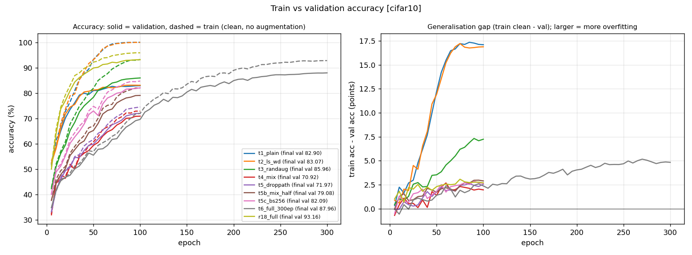
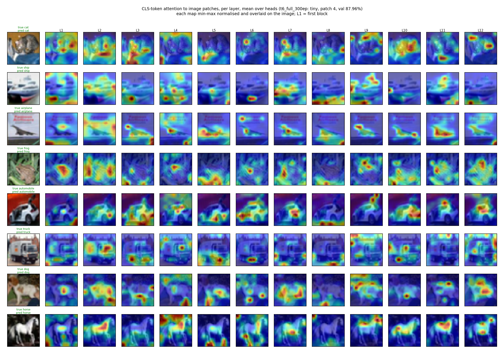
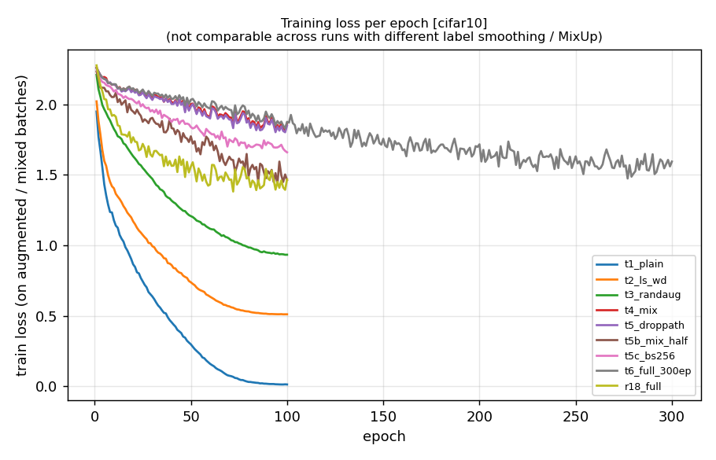
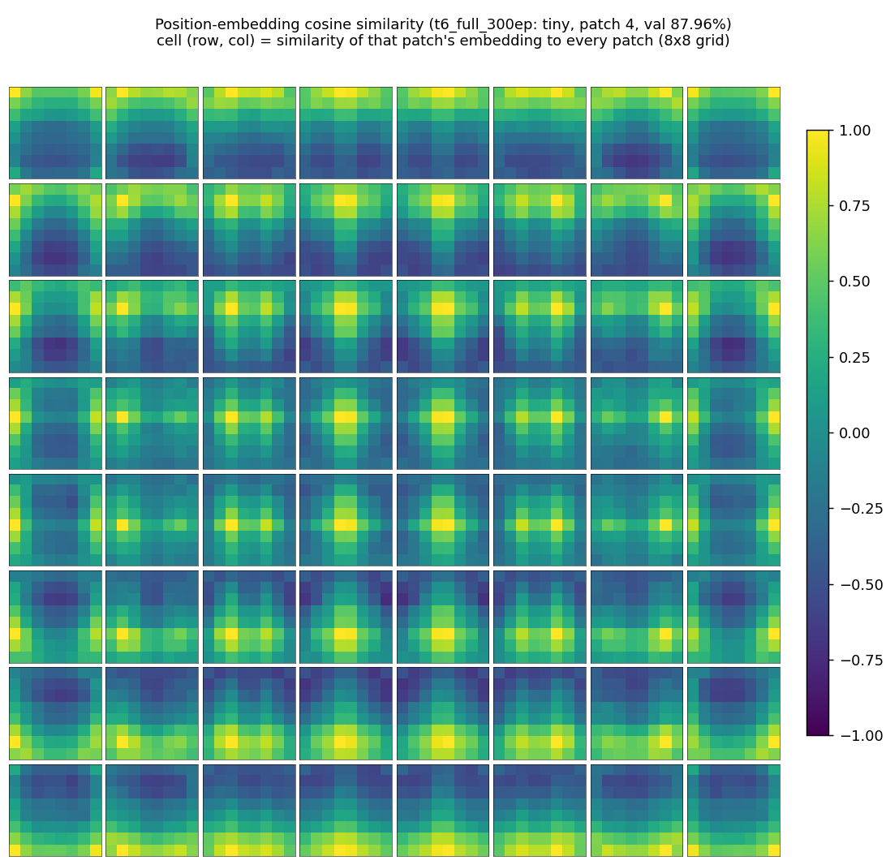
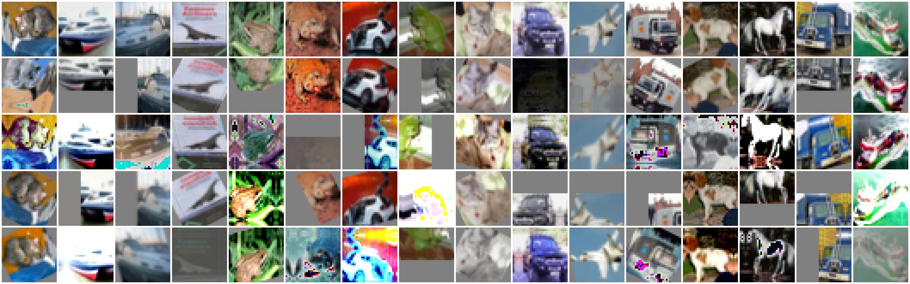
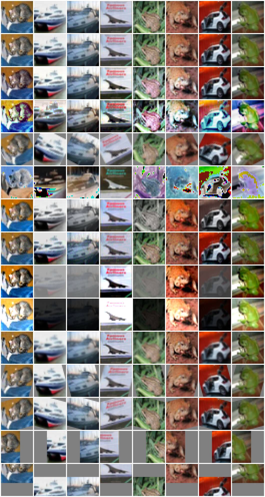
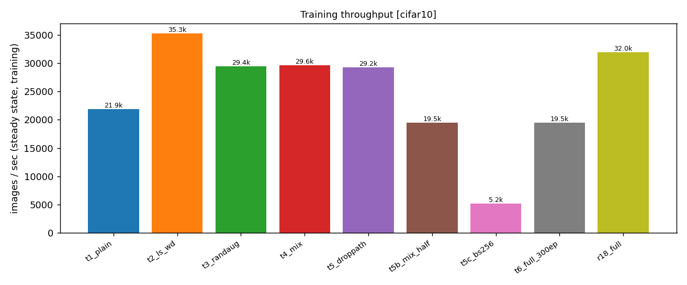

# ViT training report

_Generated 2026-10-10 16:35 from `/home/ubuntu/workspace/vision_models/ViT/runs`; 13 runs included._

Gap = clean train acc minus val acc (points). Val acc shows final epoch, best in parentheses when different.

## Compute summary

| section | runs done | pending | GPU minutes | cost |
|---|---|---|---|---|
| CIFAR-10 | 13 | 0 | 89.1 | $4.88 |
| CIFAR-100 | 0 | 8 | 0.0 | $0.00 |
| Tiny-ImageNet | 0 | 8 | 0.0 | $0.00 |
| ImageNet-64 | 0 | 4 | 0.0 | $0.00 |
| **Total** | 13 | 20 | **89.1** (1.48 h) | **$4.88** at $3.29/h |

## CIFAR-10

| run | epochs | params (M) | clean train acc | val acc | train-val gap | minutes | img/s | what this step taught |
|---|---|---|---|---|---|---|---|---|
| t1_plain | 100 | 5.36 | 100.00 | 82.90 | 17.1 | 4.3 | 21,861 | baseline (crop+flip only) |
| t2_ls_wd | 100 | 5.36 | 99.95 | 83.07 (83.11) | 16.9 | 2.6 | 35,280 | +label smoothing+weight decay: val +0.2 pts, gap shrinks 17→17 |
| t3_randaug | 100 | 5.36 | 93.21 | 85.96 | 7.2 | 3.0 | 29,440 | +RandAugment: val +2.9 pts, gap shrinks 17→7 |
| t4_mix | 100 | 5.36 | 72.89 | 70.92 | 2.0 | 3.0 | 29,650 | +MixUp/CutMix: val -15.0 pts, gap shrinks 7→2 |
| t5_droppath | 100 | 5.36 | 74.53 | 71.97 | 2.6 | 3.6 | 29,233 | +drop-path: val +1.0 pts, gap grows 2→3 |
| t6_full_300ep | 300 | 5.36 | 92.80 | 87.96 | 4.8 | 12.9 | 19,535 | epochs 100->300: val +16.0 pts, gap grows 3→5 |
| r18_full | 100 | 11.17 | 95.86 | 93.16 | 2.7 | 3.0 | 31,982 | vs matching ViT (t5_droppath): val +21.2 pts (better), gap 3 vs 3, 0.8x the time; conv inductive bias helps at this budget |
| s_small_200ep | 200 | 21.34 | 59.50 | 58.03 (58.13) | 1.5 | 11.0 | 16,073 | ViT-Small vs Tiny (t5_droppath): val -13.9 pts, 21.3M vs 5.4M params, 200 vs 100 epochs |
| p8_tiny | 100 | 5.38 | 58.63 | 57.38 | 1.2 | 4.5 | 20,565 | patch 8: tokens = (32/8)^2 = 16 vs 64 for patch 4; val -14.6 pts, 0.70x img/s (slower); fewer tokens buy speed at some accuracy cost |
| p2_tiny | 100 | 5.39 | 77.83 | 75.01 | 2.8 | 9.8 | 9,143 | patch 2: tokens = (32/2)^2 = 256 vs 64 for patch 4; val +3.0 pts, 0.31x img/s (slower); more tokens cost throughput for accuracy |
| s_small_200ep_lr1e-3 | 200 | 21.34 | 82.44 | 78.64 (78.97) | 3.8 | 10.6 | 16,117 | ViT-Small vs Tiny (t5_droppath): val +6.7 pts, 21.3M vs 5.4M params, 200 vs 100 epochs |
| t5b_mix_half | 100 | 5.36 | 81.98 | 79.08 | 2.9 | 4.4 | 19,504 | no comparison available |
| t5c_bs256 | 100 | 5.36 | 84.74 | 82.09 | 2.6 | 16.5 | 5,198 | no comparison available |

Subtotal: **89.1 GPU min** (1.48 h), **$4.88**

## CIFAR-100

_No runs yet; all rows pending._

| run | epochs | params (M) | clean train acc | val acc | train-val gap | minutes | img/s | what this step taught |
|---|---|---|---|---|---|---|---|---|
| c100_t1_plain | pending | pending | pending | pending | pending | pending | pending |  |
| c100_t2_ls_wd | pending | pending | pending | pending | pending | pending | pending |  |
| c100_t3_randaug | pending | pending | pending | pending | pending | pending | pending |  |
| c100_t4_mix | pending | pending | pending | pending | pending | pending | pending |  |
| c100_t5_droppath | pending | pending | pending | pending | pending | pending | pending |  |
| c100_t6_full_300ep | pending | pending | pending | pending | pending | pending | pending |  |
| c100_r18_full | pending | pending | pending | pending | pending | pending | pending |  |
| c100_s_small_200ep | pending | pending | pending | pending | pending | pending | pending |  |

Subtotal: **0.0 GPU min** (0.00 h), **$0.00**

## Tiny-ImageNet

_No runs yet; all rows pending._

| run | epochs | params (M) | clean train acc | val acc | train-val gap | minutes | img/s | what this step taught |
|---|---|---|---|---|---|---|---|---|
| tin_t1_plain | pending | pending | pending | pending | pending | pending | pending |  |
| tin_t2_ls_wd | pending | pending | pending | pending | pending | pending | pending |  |
| tin_t3_randaug | pending | pending | pending | pending | pending | pending | pending |  |
| tin_t4_mix | pending | pending | pending | pending | pending | pending | pending |  |
| tin_t5_droppath | pending | pending | pending | pending | pending | pending | pending |  |
| tin_r18_full | pending | pending | pending | pending | pending | pending | pending |  |
| tin_s_small_200ep | pending | pending | pending | pending | pending | pending | pending |  |
| tin_p4_tiny | pending | pending | pending | pending | pending | pending | pending |  |

Subtotal: **0.0 GPU min** (0.00 h), **$0.00**

## ImageNet-64

_No runs yet; all rows pending._

| run | epochs | params (M) | clean train acc | val acc | train-val gap | minutes | img/s | what this step taught |
|---|---|---|---|---|---|---|---|---|
| in64_t1_plain | pending | pending | pending | pending | pending | pending | pending |  |
| in64_t5_full | pending | pending | pending | pending | pending | pending | pending |  |
| in64_r18_full | pending | pending | pending | pending | pending | pending | pending |  |
| in64_s_small_full | pending | pending | pending | pending | pending | pending | pending |  |

Subtotal: **0.0 GPU min** (0.00 h), **$0.00**

## What I learned

## Why plain ViT overfits

TODO: one line on the train/val gap of t1_plain and why (no inductive bias, small data).

## Which regularizers mattered most

TODO: one line ranking label smoothing/WD, RandAugment, MixUp/CutMix, drop-path by val gain and gap reduction.

## ViT vs ResNet-18

TODO: one line comparing r18_full to the matching ViT run (accuracy, time, gap).

## Patch size / sequence length tradeoff

TODO: one line on tokens vs accuracy vs img/s for patch 2/4/8.

## Scaling to bigger datasets

TODO: one line on how the ViT-vs-ResNet picture changes from CIFAR to Tiny-ImageNet to ImageNet-64.
